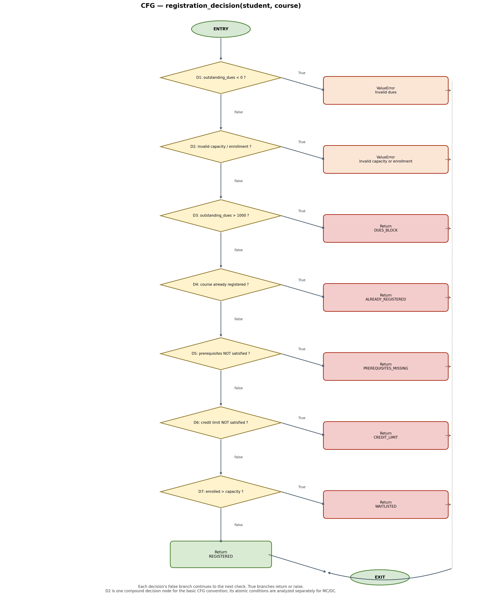

# B1 – Control Flow Graph and Cyclomatic Complexity

## 1. Function Under Test

The function selected for white-box analysis is `registration_decision()` in `registration.py`.

It checks whether a student can register for a course. It validates dues and course capacity, then checks registration status, prerequisites, credit limits, and course availability.

## 2. Cyclomatic Complexity

Cyclomatic complexity measures the number of linearly independent paths through a program.

Using the decision-node method:

**V(G) = Number of decision nodes + 1**

The function contains seven top-level decision points:

1. `student.outstanding_dues < 0`
2. `not 0 <= course.enrolled <= course.capacity or course.capacity < 1`
3. `student.outstanding_dues > 1000`
4. `course.code in student.registered_courses`
5. `not prerequisites_satisfied(...)`
6. `not check_credit_limit(...)`
7. `course.enrolled > course.capacity`

Therefore:

**V(G) = 7 + 1 = 8**

The cyclomatic complexity is **8**, meaning that eight linearly independent paths are required for a basis set.

Note: The compound condition at decision 2 is counted as one top-level decision for this McCabe calculation. Its individual conditions are considered separately in the MC/DC analysis.

### Short-Circuit Evaluation and Counting Convention

The capacity-validation expression is:

`not 0 <= course.enrolled <= course.capacity or course.capacity < 1`

For the cyclomatic complexity calculation, this entire expression is treated as one top-level compound decision node.

Python evaluates the chained comparison from left to right. If `0 <= course.enrolled` is False, the second comparison in the chain is not evaluated. Also, because the expression uses the `or` operator, `course.capacity < 1` is not evaluated when the left-hand side of the `or` is already True.

These short-circuit evaluation rules affect which atomic conditions are evaluated during execution. However, the compound expression is counted as one top-level decision for the simplified CFG and McCabe decision-node calculation used in this report.

The individual atomic conditions and their True, False and Not Evaluated outcomes are examined separately in B3 using condition coverage and MC/DC analysis.

## 3. Independent Basis Paths

| Path | Conditions followed | Expected result |
|---|---|---|
| P1 | All seven decisions evaluate to False | `REGISTERED` |
| P2 | Decision 1 evaluates to True | `ValueError: Invalid dues` |
| P3 | Decision 1 is False; decision 2 is True | `ValueError: Invalid capacity or enrollment` |
| P4 | Decisions 1–2 are False; decision 3 is True | `DUES_BLOCK` |
| P5 | Decisions 1–3 are False; decision 4 is True | `ALREADY_REGISTERED` |
| P6 | Decisions 1–4 are False; decision 5 is True | `PREREQUISITES_MISSING` |
| P7 | Decisions 1–5 are False; decision 6 is True | `CREDIT_LIMIT` |
| P8 | Decisions 1–6 are False; decision 7 is True | `WAITLISTED` |

### Important observation about P8

P8 is structurally present in the source code, but it is infeasible with valid inputs. The earlier capacity validation rejects `course.enrolled > course.capacity` before execution can reach decision 7. Therefore, the `WAITLISTED` outcome cannot be reached through this function as currently implemented.

## 4. CFG Image

The Control Flow Graph (CFG) for `registration_decision()` is shown below.

### Processing Nodes Clarification

The selected function does not contain standalone processing or assignment statements between its decision points and return statements. Its validation operations and helper-function calls are embedded directly within the decision expressions. Therefore, the CFG represents these operations within the decision nodes rather than introducing separate processing nodes. Entry, decision, return and exit nodes are explicitly represented in the diagram.

## 5. Conclusion

The cyclomatic complexity of `registration_decision()` is **8**. Eight independent paths form the theoretical basis set. However, P8 cannot be executed with valid inputs because the earlier capacity validation prevents it from being reached. This is an important structural finding that will be considered during test design.

## 6. Explicit Cyclomatic Complexity Calculation Using E and N

The simplified Control Flow Graph contains:

- N = 17 nodes
- E = 23 edges
- P = 1 connected component

Using the cyclomatic complexity formula:

V(G) = E - N + 2P

V(G) = 23 - 17 + 2(1)

V(G) = 8

Therefore, the cyclomatic complexity is 8.

This result agrees with the decision-node method:

V(G) = Number of top-level decisions + 1
V(G) = 7 + 1 = 8

The compound capacity-validation expression is counted as
one top-level decision for this calculation. Its individual
atomic conditions are analysed separately in B3.

## 7. Representative Tests for the Independent Basis Paths

The following representative test cases correspond to the
eight identified basis paths.

| Path | Representative Test | Input Conditions | Expected Outcome |
|------|---------------------|------------------|------------------|
| P1 | TC-P1 | Valid student, no dues, valid course, no prerequisites | REGISTERED |
| P2 | TC-P2 | Student outstanding dues = -1 | ValueError: Invalid dues |
| P3 | TC-P3 | Course capacity = 5, enrolled = 6 | ValueError: Invalid capacity or enrollment |
| P4 | TC-P4 | Student outstanding dues = 1001 | DUES_BLOCK |
| P5 | TC-P5 | Course code already exists in student's registered_courses | ALREADY_REGISTERED |
| P6 | TC-P6 | Required prerequisite is not completed | PREREQUISITES_MISSING |
| P7 | TC-P7 | Current credits = 16, new course credits = 3 | CREDIT_LIMIT |
| P8 | TC-P8 | Course enrolled = 6, capacity = 5, attempting to reach D7 | Not reachable; earlier capacity validation raises ValueError |

### Detailed Representative Test Inputs

TC-P1 - Successful registration:
- Student outstanding dues: 0
- Current credits: 0
- Course credit hours: 3
- Course capacity: 5
- Course enrolled: 0
- Prerequisites: empty
- Expected result: REGISTERED

TC-P2 - Invalid dues:
- Student outstanding dues: -1
- Expected result: ValueError("Invalid dues")

TC-P3 - Invalid capacity or enrollment:
- Course capacity: 5
- Course enrolled: 6
- Expected result: ValueError("Invalid capacity or enrollment")

TC-P4 - Dues blocking:
- Student outstanding dues: 1001
- All earlier validation conditions are false.
- Expected result: DUES_BLOCK

TC-P5 - Already registered:
- Course code: CS101
- Student registered_courses contains CS101.
- Earlier validation and dues conditions are false.
- Expected result: ALREADY_REGISTERED

TC-P6 - Missing prerequisites:
- Course prerequisites: {"CS100"}
- Student completed_courses: empty
- Earlier validation, dues and duplicate conditions are false.
- Expected result: PREREQUISITES_MISSING

TC-P7 - Credit limit:
- Student current credits: 16
- Course credit hours: 3
- Total would be 19 credits.
- Earlier validation, dues, duplicate and prerequisite conditions are false.
- Expected result: CREDIT_LIMIT

TC-P8 - Waitlist path:
- Course enrolled: 6
- Course capacity: 5
- The earlier capacity-validation condition rejects this input.
- Expected actual result: ValueError("Invalid capacity or enrollment")

Therefore, P8 is structurally represented in the CFG but
cannot be executed through registration_decision() with
this input because the earlier validation prevents it
from reaching the WAITLISTED decision.

## 8. B1 Conclusion

The CFG contains seven top-level decision nodes, giving
a cyclomatic complexity of 8.

Both calculation methods agree:

- Edge-node method: E - N + 2P = 23 - 17 + 2 = 8.
- Decision-node method: 7 + 1 = 8.

Eight independent basis paths were identified.
Seven have representative executable outcomes, while
the WAITLISTED path is structurally infeasible under
the current validation logic.

